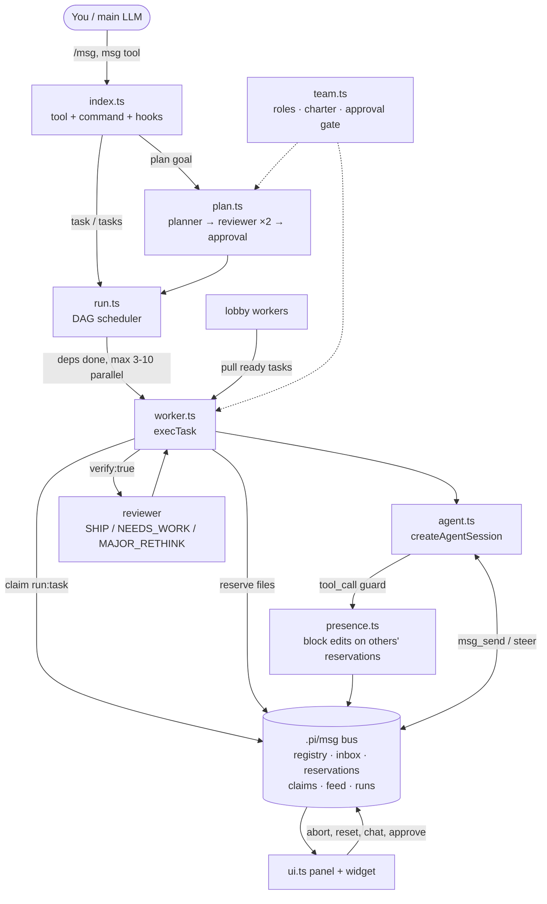
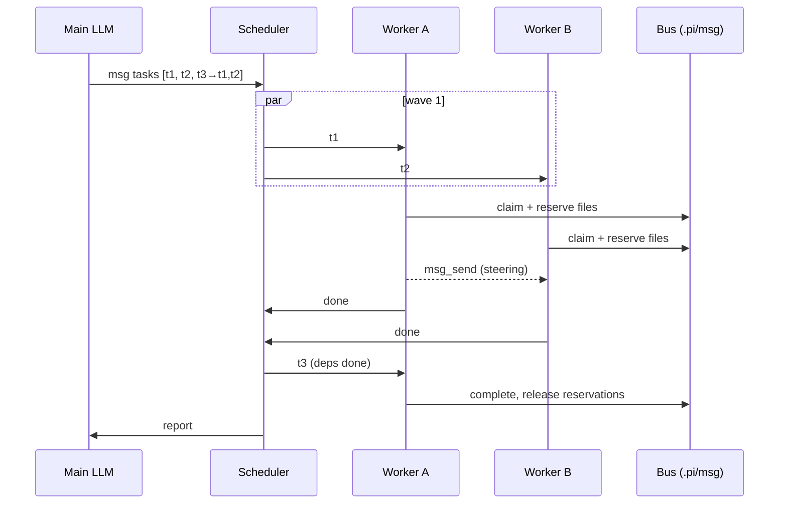

# pi-msg

Multi-agent messenger + crew orchestration for [pi](https://github.com/earendil-works/pi). In-process, zero config, no external CLI.

Install: `pi install /path/to/pi-msg` (or `pi -e ./src/index.ts`).

## Use
- `/msg` opens the panel (agents, tasks, feed, chat). `Enter` detail, `m` chat (`@Name msg`, `@all msg`), `q` stop task, `A` abort all.
- `/msg <task>` runs one worker. `/msg -m provider/id <task>` picks a model. `/msg plan <goal>` plans, asks approval, runs. `/msg resume` continues the last run.
- The LLM uses the `msg` tool: `task`, `tasks` (DAG with `deps`, `files`), `plan`, `swarm`/`claim`/`complete`, `reserve`/`release`, `send`, `feed`, `list`, `models`, `team*`.

## Notes
- State lives in `.pi/msg/` (JSON files). Models default to the current session; the LLM can override per call.
- Tasks that write must declare `files` (reserved while running); there is no worktree isolation.
- Docs: `docs/usage.md`, `docs/tool-reference.md`, `docs/architecture.md`.

## Config (optional)
`{"announce": true}` in `.pi/msg/config.json` or `~/.pi/agent/msg.json` posts the full result in chat when a `/msg` run finishes. Default: one-line notification only.

## Panel keys
`←→` DM tab, `Enter` detail, `m` chat, `p` revise task, `r` reset, `x` delete, `b` block, `q` stop, `u` unblock, `s` start, `y/n` approve, `f` feed focus, `A` abort all.
Unread messages show as `✉ N unread` in the status bar until `/msg` is opened. `/msg plan` runs up to 2 reviewer refinement passes before approval.

`S` split a task (parts separated by `;`), `l`/`L` add/remove a lobby worker (standing worker that pulls ready tasks from the current run).

## How it works

